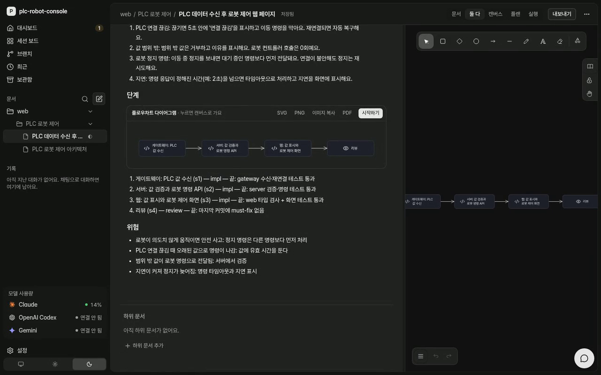

<div align="center">

# Atelier

**문서 · 다이어그램 · AI 에이전트 팀을 한 화면에서. 내 컴퓨터에서만 도는 작업실이에요.**<br>
계획을 쓰고, 코드로 그림을 그리고, 시작하기를 누르면 Claude Code · Codex · Gemini 세션이 만들어요.

[English](README.md) · **한국어**

[](CHANGELOG.md)
[](#-빠른-시작)
[](#-스킬-설치)
[](#-스킬-설치)
[](#-개인정보와-로컬-전용)

<a href="docs/images/demo.mp4"></a>

<sub>데모 영상 · <a href="docs/images/demo.mp4">MP4로 보기</a> <!-- TODO(youtube): swap the MP4 link for the YouTube link once uploaded --> · 리드와 팀원이 실제 Claude CLI로 "PLC 데이터를 받아 로봇을 움직이는 웹 페이지"를 계획해요</sub>

</div>

## ✨ 핵심 기능

- **문서 + 무한 캔버스**: 파일 하나(`*.dpx.json`)에 글과 캔버스가 같이 있어요. 문서에서 `/`로 다이어그램을 넣으면 캔버스에도 생겨요.
- **코드로 그리는 다이어그램**: 아키텍처, 플로우차트, 시퀀스, ERD. 코드를 고치면 그림이 바로 바뀌고, 노드에 코드 위치를 붙여요.
- **자유 캔버스**: 도형, 화살표, 손그림, 프레임으로 다이어그램 위를 손봐요.
- **계획과 에이전트 팀**: 리드가 계획(문서 + 단계 다이어그램)을 쓰고, `시작하기` 한 번이면 Claude Code · Codex · Gemini 세션이 각자 git worktree에서 일하고 서로 리뷰하고 PR을 열어요.
- **세션 보드**: 누가 무엇을 하는지, 작업별 단계와 남은 시간, 비용과 5시간·주간 사용량 한도를 봐요.
- **로컬 전용**: 서버는 `127.0.0.1`에만 열리고 밖으로 요청을 보내지 않아요.

## 🚀 빠른 시작

필요한 것: Node.js 22.18 이상, git

```bash
git clone https://github.com/chanyee725/Atelier.git
cd Atelier
npm install && npm run build
mkdir -p ~/atelier-notes && npm start -- ~/atelier-notes
```

터미널에 나온 주소(기본 `http://127.0.0.1:4330/`)를 브라우저로 열어요.

| 설정 | 뜻 |
|---|---|
| `<작업 폴더>` | 파일이 저장되는 폴더. 미리 만들어 둬요. |
| `DRAW_PORT` | 포트 번호. 없으면 4330. `DRAW_PORT=4340 npm start -- <작업 폴더>` |

- `npm run build`를 건너뛰면 페이지 대신 "Web app not built"가 나와요.
- 포트가 이미 쓰이고 있으면 서버가 바로 끝나고 다른 포트를 고르라고 알려줘요.

## 🔌 스킬 설치

GitHub 저장소에서 바로 설치해요. 저장소 루트의 marketplace가 `plugin/`을 가리켜요.

**Claude Code**

```text
/plugin marketplace add chanyee725/Atelier
/plugin install atelier@atelier
```

**Codex CLI**

```bash
codex plugin marketplace add chanyee725/Atelier
codex plugin add atelier@atelier
```

그다음 프로젝트에서 "아틀리에 켜줘"라고 말하거나 `atelier-setup` 스킬을 써요. 자세한 내용: [plugin/README.md](plugin/README.md)

## 🧩 스킬 7개

| 스킬 | 하는 일 | 이렇게 말해요 |
|---|---|---|
| `atelier-setup` | 프로젝트에서 서버 켜기·끄기, Claude·Codex·Gemini 연결 | "아틀리에 켜줘" |
| `atelier-update` | 최신 GitHub 릴리스로 업데이트하고 서버 다시 켜기 | "아틀리에 업데이트" |
| `atelier-team` | 이슈 하나에 리드·구현자·리뷰어 팀 꾸리기 | "팀 꾸려서 진행해" |
| `atelier-quickfix` | 1~3개 파일을 한 세션으로 빠르게 고치기 | "문구만 고쳐줘" |
| `atelier-session` | 세션 하나 띄우기, 메시지·중단·권한 응답 | "세션 하나 띄워줘" |
| `atelier-status` | 세션 상태, 남은 시간, 막힘, 사용량 한도 | "지금 뭐 하고 있어?" |
| `atelier-settings` | 비용·토큰, 한도 가드, 역할별 모델 | "역할별 모델 바꿔줘" |

## 🧭 팀이 일하는 방식

1. 리드에게 한 줄로 말해요: "PLC에서 데이터를 받아온 뒤 로봇을 움직이는 웹 페이지를 만들어야 해."
2. 리드가 팀원을 두고 계획을 써요: 요구사항, 테스트 조건, 단계, 다이어그램.
3. 계획을 읽고 `시작하기`를 눌러요. 승인은 이 한 번이에요.
4. 구현자는 git worktree에서 일하고, 새 리뷰어가 PR마다 코멘트를 달고, 병합 담당이 리뷰를 통과한 PR을 병합해요.
5. 세션 보드와 계획의 단계 다이어그램에서 모든 단계를 실시간으로 봐요.

## ✏️ 다이어그램 코드 한눈에

```
title Robot console
direction right

PLC [icon: cpu]
Gateway [icon: router]
Server [icon: server]
Web [icon: monitor]
Robot [icon: bot]

PLC > Gateway: Modbus TCP
Gateway > Server: values
Server <> Web: WebSocket
Web > Server: move command
Server > Robot: command [color: orange]
```

그룹(`이름 { ... }`), 연결(`>`, `<`, `<>`, `-`, `--`, `-->`), 라벨과 속성(`icon`, `color`, `label`, `shape`)은 Eraser의 diagram-as-code와 같아요. 종류별로 확인된 예시는 `test/dsl/fixtures/`에 있어요. 코드 편집기에서 `Ctrl+Space`로 자동완성을, 어디서나 `Ctrl/⌘+K`로 명령 팔레트를 열어요.

## 🔒 개인정보와 로컬 전용

- 서버는 `127.0.0.1`에만 열리고, 서버 코드는 밖으로 요청을 보내지 않아요. 글꼴, 아이콘, 캔버스 자산은 같이 들어 있어요.
- 작업 폴더, 그 폴더가 든 git 프로젝트, 공용 사용량 한도 폴더 안에서만 써요.
- 에이전트 대화는 메모리에만 두고, 디스크에는 단계·시간·모델·토큰·비용·브랜치·커밋·PR 번호 같은 메타데이터만 남겨요.
- 세션은 사용자가 연결한 CLI(`claude`, `codex`, `agy`)만 쓰고, 서버는 그 자격 증명을 읽지 않아요.

## 🏗 구조

```text
server/   127.0.0.1 서버: 작업 폴더 API, 계획 실행, 에이전트 세션(server/dispatch)
web/      React 앱: 문서(TipTap), 캔버스(Excalidraw), 세션 보드
shared/   다이어그램 코드 파서와 렌더러(서버·웹 공용)
plugin/   Claude Code · Codex 플러그인: 스킬 7개와 훅
scripts/  아이콘·글꼴 빌드, 패키징, 데모 녹화(record-demo.mjs)
test/     node:test 테스트, 가짜 CLI, 헤드리스 e2e
```

## 🛠 개발

| 명령 | 하는 일 |
|---|---|
| `npm test` | 서버, 파서, 렌더, 웹 로직 테스트(가짜 CLI만 써요) |
| `npm run build` | 웹 앱을 `public/`에 빌드 |
| `npm run dev:web` | Vite 개발 서버(`/api`는 4330 포트 서버로 넘겨요) |
| `node scripts/record-demo.mjs` | 데모를 다시 찍어요. 빈 포트·`/tmp` 아래 scratch 프로젝트에서 실제 Claude CLI(claude-sonnet-5-5)가 계획까지만 하고, `docs/images/demo.mp4`와 `demo-poster.png`를 써요. `CHROME`, `PLAYWRIGHT_CORE`, 로그인된 `claude`가 필요해요. `DEMO_FAKE=1`은 가짜 CLI로 스크립트만 확인해요 |

브라우저 e2e는 켤 때만 돌아요.

```
DRAW_E2E=1 CHROME=/path/to/chrome-headless-shell PLAYWRIGHT_CORE=/path/to/node_modules/playwright-core npm test
```

작업은 GitHub 이슈로 관리해요. 바뀐 점은 [CHANGELOG.md](CHANGELOG.md)에 있어요.

## 지원하지 않는 것

- 여러 사람이 동시에 편집하기, 원격 접속, 계정
- PDF 내보내기(SVG, PNG, Markdown만 돼요)
- AWS, Google Cloud, Azure 공식 아이콘(가장 비슷한 Lucide 아이콘으로 그려요)
- 시퀀스, ERD 블록의 노드 옮기기(아키텍처와 플로우차트만 돼요)
- BPMN 파서(예시 코드만 있어요)

## 라이선스

- 레이아웃에 `elkjs`(EPL-2.0)를 써요. 소스는 `node_modules/elkjs`에 그대로 있고 수정하지 않았어요.
- 캔버스에 `@excalidraw/excalidraw`(MIT, `package.json` 표기)를 써요. 그 패키지의 글꼴을 `public/excalidraw/fonts/`로 같이 묶어요. 패키지에 글꼴 라이선스 파일이 없어서 각 글꼴의 upstream 기준이에요: Assistant, Cascadia Code, Excalifont, Liberation Sans, Lilita One, Nunito, Virgil, Xiaolai(LXGW 기반)는 OFL-1.1, Comic Shanns는 MIT.
- 손글씨 글꼴(`typeface rough`)은 Shantell Sans(OFL-1.1)예요. `@fontsource/shantell-sans` 5.3.0(원본 arrowtype/shantell-sans)에서 영문·숫자·기본 문장부호의 보통 굵기만 골라 담았어요(약 25KB).
- 기본 글꼴은 Pretendard(OFL-1.1, npm `pretendard` 1.3.9)에서 영문·숫자·기본 문장부호의 400·600 굵기만 골라 담았어요(각 약 12KB). Pretendard는 예약된 글꼴 이름이라 `Drawing Sans`라는 이름으로 들어가요. 파일과 라이선스 전문은 `shared/render/fonts/`에 있고, 글꼴이 SVG에 같이 들어가서 밖으로 요청하지 않아요. 한글은 시스템 글꼴로 보여요.
- 다이어그램 아이콘은 npm 패키지에서 고른 것만 `shared/render/icon-data.ts`에 넣어요(`npm run icons`). 전문은 `NOTICE.md`에 있어요.

  | 묶음 | 쓰는 곳 | 라이선스 |
  | --- | --- | --- |
  | Lucide (`lucide-static`) | 일반 아이콘(`users`, `server`, `key` …), `aws-*`·`gcp-*`·`azure-*` 대체 아이콘 | ISC (Feather에서 온 일부는 MIT) |
  | Simple Icons (`simple-icons`) | 기술 로고(`postgres`, `k8s`, `redis` …) | CC0-1.0 (개별 라이선스가 붙은 로고는 넣지 않아요) |

  로고는 각 회사의 상표예요. AWS·Google Cloud·Azure 공식 아이콘은 넣지 않았어요. 모르는 이름은 점선 상자로 그려요.
