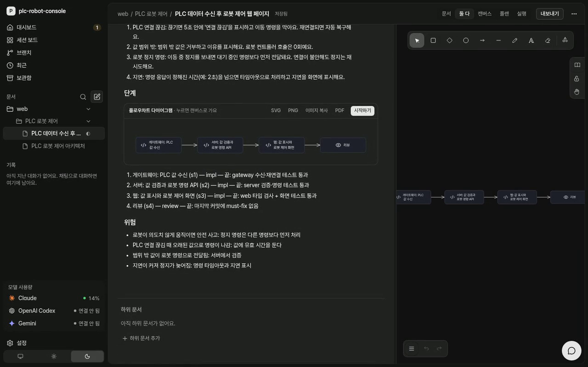

<div align="center">

# Atelier

**Docs, diagrams and AI agent teams in one local workspace.**<br>
Write a plan, draw it as code, press Start, and watch Claude Code, Codex and Gemini sessions build it.

**English** · [한국어](README.ko.md)

[](CHANGELOG.md)
[](#-quick-start)
[](#-install-the-skills)
[](#-install-the-skills)
[](#-privacy-and-local-only)

<a href="docs/images/demo.mp4"></a>

<sub>Demo video · <a href="docs/images/demo.mp4">Watch the MP4</a> <!-- TODO(youtube): swap the MP4 link for the YouTube link once uploaded --> · a lead and a teammate plan "a web page that takes PLC data and moves a robot" with the real Claude CLI</sub>

</div>

## ✨ Features

- **Document + infinite canvas**: one file (`*.dpx.json`) holds the text and the canvas. Type `/` in a document to add a diagram; it shows on the canvas too.
- **Diagrams as code**: architecture, flowchart, sequence and ERD. Edit the code and the picture follows; nodes carry links to the code they describe.
- **Free-form canvas**: shapes, arrows, freehand and frames on top of any diagram.
- **Plans and agent teams**: a lead writes a plan (document + step diagram). One press of `시작하기` (Start) and Claude Code, Codex or Gemini sessions work in their own git worktrees, review each other and open PRs.
- **Session board**: who does what, stage and time left per task, cost and the 5-hour and weekly usage limits.
- **Local only**: the server listens on `127.0.0.1` and sends nothing out.

## 🚀 Quick start

You need Node.js 22.18+ and git.

```bash
git clone https://github.com/chanyee725/Atelier.git
cd Atelier
npm install && npm run build
mkdir -p ~/atelier-notes && npm start -- ~/atelier-notes
```

Open the address it prints (default `http://127.0.0.1:4330/`).

| Setting | Meaning |
|---|---|
| `<workspace>` | The folder your files live in. Create it first. |
| `DRAW_PORT` | Port, 4330 when unset. `DRAW_PORT=4340 npm start -- <workspace>` |

- Without `npm run build` the page says "Web app not built".
- When the port is taken, the server stops at once and asks for another one.

## 🔌 Install the skills

Install straight from GitHub; the marketplace at the repo root points at `plugin/`.

**Claude Code**

```text
/plugin marketplace add chanyee725/Atelier
/plugin install atelier@atelier
```

**Codex CLI**

```bash
codex plugin marketplace add chanyee725/Atelier
codex plugin add atelier@atelier
```

Then say "Atelier 켜줘" (or run the `atelier-setup` skill) in a project. Details: [plugin/README.md](plugin/README.md).

## 🧩 7 skills

| Skill | What it does | Say |
|---|---|---|
| `atelier-setup` | Start or stop the server for a project; connect Claude, Codex, Gemini | "start Atelier" |
| `atelier-update` | Update to the latest GitHub release and restart servers | "update Atelier" |
| `atelier-team` | A lead, implementers and reviewers for one issue | "run this as a team" |
| `atelier-quickfix` | A 1–3 file change in one session | "just fix the copy" |
| `atelier-session` | One session: start, message, interrupt, permissions | "start one session" |
| `atelier-status` | Sessions, ETAs, stuck flags, usage limits | "what's everyone doing?" |
| `atelier-settings` | Cost and tokens, limit guard, model per role | "change the model per role" |

## 🧭 How a team runs

1. Tell a lead what you need, in one line: "We need a web page that takes PLC data and moves a robot."
2. The lead adds teammates and writes a plan: requirements, test conditions, steps, and diagrams.
3. You read the plan and press `시작하기`. That is the only approval.
4. Implementers work in git worktrees, a fresh reviewer comments on each PR, and the merge role merges reviewed PRs.
5. The session board and the plan's step diagram show every step live.

## ✏️ Diagram code at a glance

```
title Robot console
direction right

PLC [icon: cpu]
Gateway [icon: router]
Server [icon: server]
Web [icon: monitor]
Robot [icon: bot]

PLC > Gateway: Modbus TCP
Gateway > Server: values
Server <> Web: WebSocket
Web > Server: move command
Server > Robot: command [color: orange]
```

Groups (`Name { ... }`), edges (`>`, `<`, `<>`, `-`, `--`, `-->`), labels and attributes (`icon`, `color`, `label`, `shape`) work as in Eraser's diagram-as-code. Tested examples of every type are in `test/dsl/fixtures/`. In the code editor `Ctrl+Space` opens autocomplete, and `Ctrl/⌘+K` opens the command palette anywhere.

## 🔒 Privacy and local only

- The server listens on `127.0.0.1` only, and its code makes no outbound requests. Fonts, icons and canvas assets are bundled.
- It writes only inside the workspace, the git project that holds it, and a shared usage-limit folder.
- Agent transcripts stay in memory. Disk keeps metadata only: steps, times, model, tokens, cost, branch, commit, PR number.
- Sessions use only the CLIs you connected (`claude`, `codex`, `agy`), and the server never reads their credentials.

## 🏗 Layout

```text
server/   127.0.0.1 server: workspace API, plan runs, agent sessions (server/dispatch)
web/      React app: documents (TipTap), canvas (Excalidraw), session board
shared/   diagram-code parser and renderer, shared by server and web
plugin/   Claude Code and Codex plugin: 7 skills and hooks
scripts/  icon and font builds, packaging, demo recording (record-demo.mjs)
test/     node:test tests, fake agent CLIs, headless e2e
```

## 🛠 Development

| Command | What it does |
|---|---|
| `npm test` | server, parser, render and web logic tests (fake CLIs only) |
| `npm run build` | build the web app into `public/` |
| `npm run dev:web` | Vite dev server (`/api` goes to the server on 4330) |
| `node scripts/record-demo.mjs` | re-record the demo: a scratch project under `/tmp` on a free port, the real Claude CLI (claude-sonnet-5-5) planning only; writes `docs/images/demo.mp4` and `demo-poster.png`. Needs `CHROME`, `PLAYWRIGHT_CORE` and a logged-in `claude`; `DEMO_FAKE=1` checks the script with the fake CLI |

Browser e2e tests are skipped unless you turn them on:

```
DRAW_E2E=1 CHROME=/path/to/chrome-headless-shell PLAYWRIGHT_CORE=/path/to/node_modules/playwright-core npm test
```

Work is tracked in GitHub issues; changes are in [CHANGELOG.md](CHANGELOG.md).

## Not supported

- Real-time multi-user editing, remote access, accounts
- PDF export (SVG, PNG and Markdown only)
- Official AWS, Google Cloud and Azure icons (the closest Lucide icon is drawn instead)
- Moving nodes by hand in sequence and ERD blocks (architecture and flowchart only)
- A BPMN parser (example code only)

## License notes

- Layout uses `elkjs` (EPL-2.0), unmodified in `node_modules/elkjs`.
- The canvas uses `@excalidraw/excalidraw` (MIT, per `package.json`). The fonts in that package ship in `public/excalidraw/fonts/`; the package has no font license files, so these follow each font's upstream: Assistant, Cascadia Code, Excalifont, Liberation Sans, Lilita One, Nunito, Virgil, Xiaolai (LXGW based) under OFL-1.1, and Comic Shanns under MIT.
- The handwritten diagram font (`typeface rough`) is Shantell Sans (OFL-1.1), subset from `@fontsource/shantell-sans` 5.3.0 (upstream arrowtype/shantell-sans) to Latin letters, digits and basic punctuation at regular weight (~25 KB).
- The default diagram font is a subset of Pretendard (OFL-1.1, npm `pretendard` 1.3.9): Latin letters, digits and basic punctuation at weights 400 and 600 (~12 KB each). Pretendard is a reserved font name, so the subset is named `Drawing Sans`. Font files and full licenses are in `shared/render/fonts/`; fonts are embedded in the SVG, so nothing is fetched. Hangul uses the system font.
- Diagram icons are picked from npm packages into `shared/render/icon-data.ts` (`npm run icons`); full texts are in `NOTICE.md`.

  | Set | Used for | License |
  | --- | --- | --- |
  | Lucide (`lucide-static`) | general icons (`users`, `server`, `key` …) and stand-ins for `aws-*`, `gcp-*`, `azure-*` | ISC (parts from Feather are MIT) |
  | Simple Icons (`simple-icons`) | technology logos (`postgres`, `k8s`, `redis` …) | CC0-1.0 (logos with their own license are left out) |

  Logos are their companies' trademarks. No official AWS, Google Cloud or Azure icons are included; unknown names draw a dashed box.
